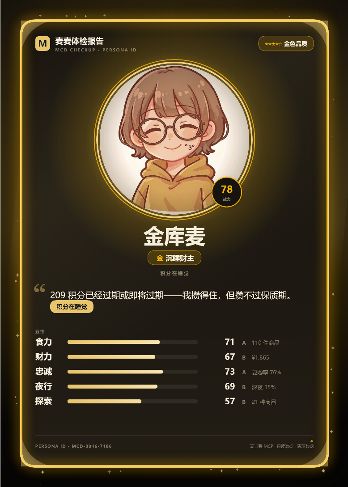
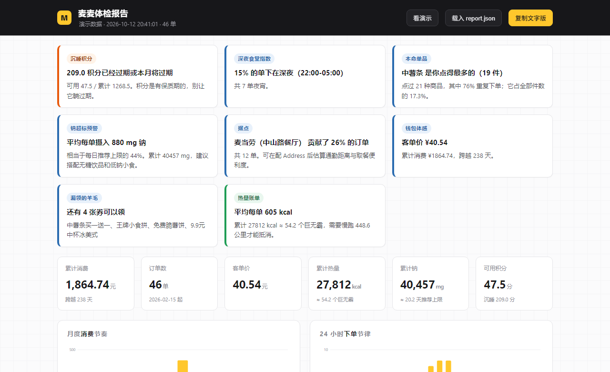
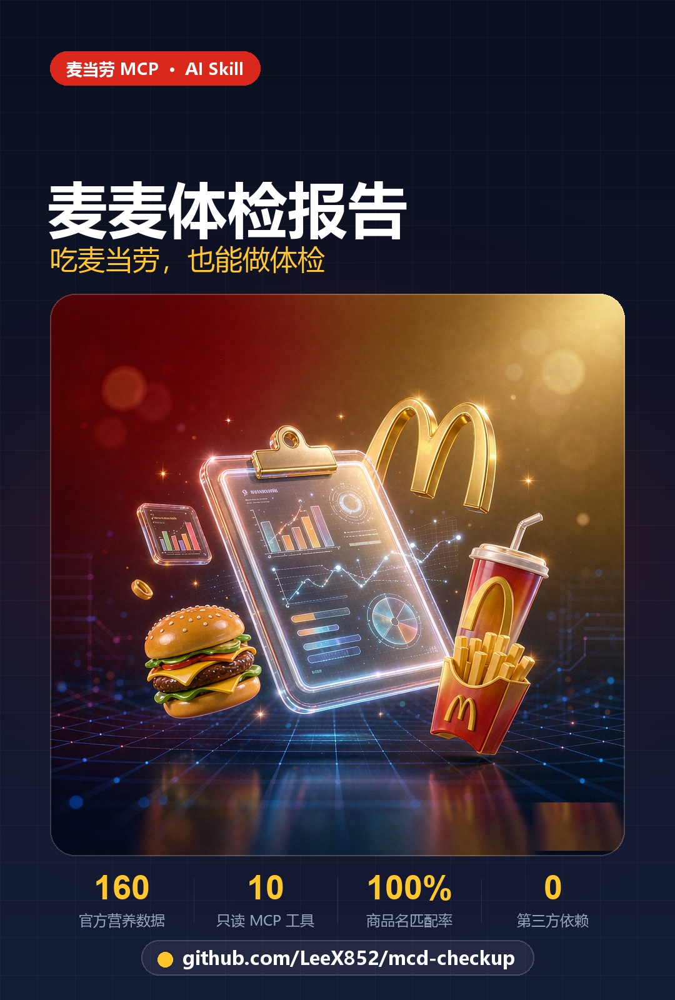
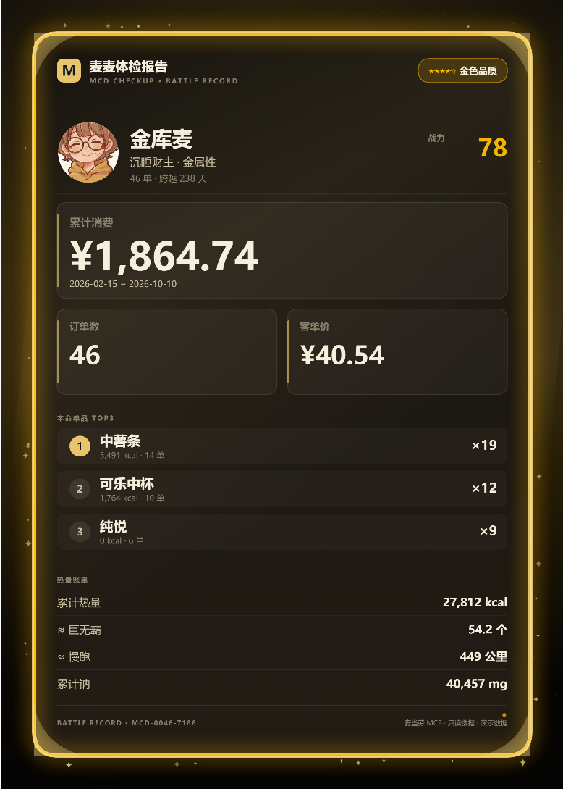
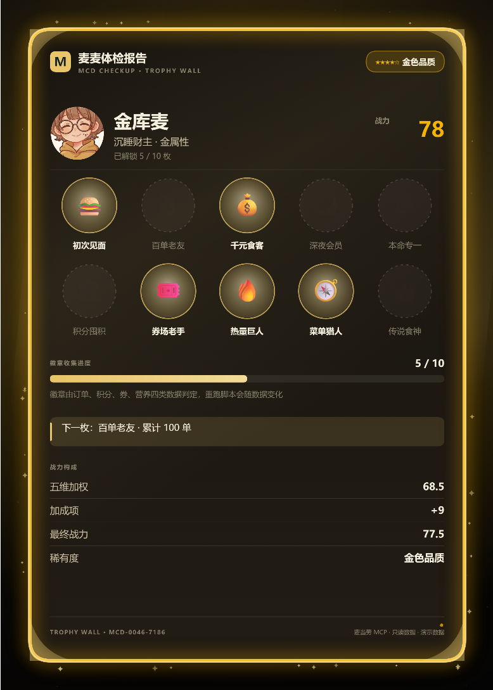

# 🍔 麦麦体检报告 · mcd-checkup

> 你在麦当劳花了多少钱、吃了多少热量、攒了多少没用的积分？一条命令，生成一份能发朋友圈的体检报告，
> 再把你这一年的吃法，抽成一张带品质光晕的角色卡。

基于 **麦当劳 MCP Server** 的只读能力，把历史订单、积分账户、优惠券、餐品营养四类数据打通，
算出一份带结论的可视化体检报告；同一份数据再推导出一套**用户画像**，生成专属角色卡
（蓝 / 绿 / 紫 / 金 / 红五档稀有度、五种卡面、五套主题，可导出 PNG 分享）。
**纯 Python 标准库，零第三方依赖；两个产物都是单文件 HTML，双击即开。**







---

## 为什么做这个

麦当劳 MCP 提供了 35 个工具，但单看 `order-list` 只是一串流水账——知道"买了什么"，不知道"这意味着什么"。

这个 Skill 做的事情很简单：**把散落的接口数据交叉起来，回答三个问题。**

| 问题 | 用到的 MCP 工具 | 产出结论 |
|---|---|---|
| 我这一年到底吃了多少？ | `order-list` × `list-nutrition-foods` | 累计热量 ≈ 多少个巨无霸 / 要慢跑多少公里；钠摄入是否超每日推荐上限 |
| 我的钱花得值吗？ | `order-list` × `query-my-account` | 客单价、月度节奏、24 小时下单节律、本命单品 TOP10 |
| 有什么我白白浪费了？ | `query-my-account` × `available-coupons` | 沉睡积分预警、还没领的券 |

## 快速开始

### 方式一：命令行（推荐）

```bash
# 1. 克隆仓库
git clone https://github.com/<你的账号>/mcd-checkup.git
cd mcd-checkup

# 2. 配置 MCP Token（从 https://open.mcd.cn/mcp 申请）
export MCD_MCP_TOKEN="你的MCP_TOKEN"

# 3. 抓数 + 分析（同时产出 report.json 与 card.json）
python scripts/checkup.py --out report.json

# 4. 渲染两个单文件页面
python scripts/render.py --data report.json --out report.html --card-out card.html
```

打开 `report.html` 看报告，`card.html` 看角色卡。**没有 Token 也能跑：**

```bash
python scripts/checkup.py --sample --out report.json   # 用内置演示数据
python scripts/render.py                                # 直接打包演示版
```

### 方式二：作为 WorkBuddy Skill 使用

把本仓库放进 Skill 目录，然后在对话里直接说：

> 「帮我做一份麦麦体检报告」

Skill 会自动抓数、分析，并只汇报关键结论（深夜食堂指数、沉睡积分、本命单品……）。
详见 [SKILL.md](SKILL.md)。

## 报告里有什么

| 模块 | 内容 |
|---|---|
| 体检结论 | 按严重程度排序的结论卡：深夜食堂指数、钠超标预警、本命单品、沉睡积分、漏领的羊毛…… |
| 核心指标 | 累计消费 / 订单数 / 客单价 / 累计热量 / 累计钠 / 可用积分 |
| 月度消费节奏 | 按月消费柱状图 |
| 24 小时下单节律 | 按小时分布，深夜时段（22:00–05:00）单独标色 |
| 一周分布 | 周几最勤 |
| 营养素构成 | 蛋白质 / 脂肪 / 碳水占比环形图 + 平均每单热量与钠 |
| 本命单品 TOP10 | 件数、下单次数、累计热量、占比条 |
| 积分账本 | 可用 / 累计 / 已用 / 已过期 / 本月将过期 / 下月将过期 |
| 钱包与商城 | 持有券、可领券、抽奖奖池、商城订单、营养表匹配率 |

报告页支持**拖入 `report.json`** 查看自己的数据、一键**复制文字版**（适合发群），
右上角「角色卡」按钮直达卡片页。

---

## 麦麦角色卡

体检报告是事实层，角色卡是叙事层：**同一份数据，第二次表达。**

### 怎么衔接

```
10 个只读 MCP 工具 → analyze.py → report.json（含 persona）
                                        ├→ report.html   体检报告
                                        └→ card.py → card.json → card.html   角色卡 → PNG
```

画像不新增任何 MCP 调用——深夜占比、复购率、沉睡积分、本命单品本来就已算过，
`persona.py` 只是把它们翻译成称号、五维、稀有度和外观参数。
**Token 消耗不变，限流风险不变，只读白名单不变。**

同一账号永远得到同一个角色：外观由账号指纹（首末订单日期 + 订单数 + 消费 + 件数 + 门店）
播种，重跑不会「重 roll」，卡号 `MCD-0046-7186` 可复现、可对比。

### 五种卡面

| 卡面 | 回答什么 | 主要区块 |
|---|---|---|
| **角色卡** PERSONA ID | 我是谁 | 圆形立绘窗 + 称号 + 台词 + 五维（含 S/A/B 评级）+ 战力徽章 |
| **战绩卡** BATTLE RECORD | 我花了多少 | 累计消费 / 订单数 / 客单价 / 本命 TOP3 / 热量账单 |
| **节律卡** DAILY RHYTHM | 我什么时候吃 | 24 小时柱状（深夜标橙）/ 深夜指数 / 常去门店 / 一周分布 |
| **钱包卡** WALLET LEDGER | 我亏了多少 | 可用 vs 沉睡积分 / 积分损耗率半环 / 券与商城 / 待领券 |
| **徽章卡** TROPHY WALL | 我解锁了什么 | 10 枚成就徽章 / 收集进度 / 下一目标 / 战力构成 |




### 立绘：8 张卡池

角色形象来自 `assets/characters/` 的 8 张半身立绘（每个原型一张，ImageGen 生成后落库），
构建时**只把当前账号命中的那张 base64 内联进 `card.html`**，所以产物仍是单文件、可离线打开。

| 原型 | 立绘特征 |
|---|---|
| 深夜守夜人 | 黑发困倦脸 + 耳机 + 紫调卫衣 |
| 本命信徒 | 栗色短发 + 红棒球帽 + 红卫衣 |
| 沉睡财主 | 浅棕波波头 + 圆眼镜 + 芥末黄卫衣 |
| 探店猎人 | 青绿高马尾 + 黄围巾 |
| 精算猎人 | 方框眼镜 + 挑眉坏笑 |
| 热量战士 | 炸毛短发 + 橙红外套 |
| 日常打卡人 | 侧分短发 + 棕色开衫 |
| 麦麦新客 | 齐肩黑发 + 红丝带 |

立绘不做抠图，而是在卡片侧用**圆形取景**：cover 填满圆窗，边缘全部裁掉，
外面套品质色光边与双环。素材缺失时自动退回程序化绘制的 chibi 角色，卡片依然能出。

### 五套主题

经典红黄 / 深夜电波 / 手账米白 / 赛博荧光 / 金箔典藏。
主题随画像自动匹配（深夜守夜人 → 深夜电波，沉睡财主 → 金箔典藏），也可在页面左侧手动切换。

### 五档品质（稀有度光晕）

| 品质 | 门槛（战力） | 光晕表现 |
|---|---|---|
| 蓝色品质 · 普通 | 0 | 冷蓝微光 |
| 绿色品质 · 精良 | 40 | 青绿光边 |
| 紫色品质 · 稀有 | 56 | 紫光 + 边缘星屑 |
| 金色品质 · 史诗 | 72 | 金光 + 四角光楔 + 斜向高光 |
| 红色品质 · 传说 | 87 | 红光 + 双层光楔 + 密集星屑 |

光晕由五层叠加：**环境径向光 → 三层 shadowBlur 描边 → 四角光楔 → 边缘星屑 → 斜向高光**，
缩成缩略图也能一眼分辨蓝卡和红卡。战力 = 五维加权 + 加成项（长期陪伴 / 本命专一 / 券场活跃…）。

### 导出

| 项 | 值 |
|---|---|
| 预览尺寸 | 1080 × 1512（约 5:7 卡牌比例） |
| 导出尺寸 | 2160 × 3024 PNG（2 倍图，放大不糊） |
| 操作 | 电脑点「保存图片」/「复制图片」；手机长按卡面保存 |
| 隐私 | 完全本地 Canvas 生成，不上传数据；卡面只有昵称、称号、汇总指标和卡号 |

预览与导出是**同一块 Canvas、同一份绘制代码**，所见即所得，不存在截图错位。
页面还支持深链直出，方便批量出图：

```
card.html?bare=1&card=id&theme=midnight&rarity=gold
```

完整规则（五维公式、原型判定表、内容构成、光晕实现）见 [CARD_DESIGN.md](CARD_DESIGN.md)。

---

## 目标用户

- **想复盘自己麦当劳消费的人**——尤其是办了麦金卡、攒了一堆积分不知道用没用的人
- **健身 / 控卡人群**——需要知道"这顿麦满分顶几碗米饭"
- **想理解数据能玩出什么花样的人**——把账单变成"抽卡"，把 209 分沉睡积分变成一张金色角色卡
- **想快速理解麦当劳 MCP 能干什么的开发者**——10 个只读工具串成一条完整数据链路，再派生一层画像
- **参赛评委**——仓库自带演示数据与两个成品页面，无需 Token 即可查看效果

## 目录结构

```
mcd-checkup/
├── SKILL.md                  # Skill 定义（触发词 + 工作流 + 硬性约束）
├── README.md                 # 本文件
├── CARD_DESIGN.md            # 角色卡设计说明（衔接 / 卡面 / 品质 / 导出）
├── CONTEST_DECLARATION.md    # 参赛声明（官方原文，不可改动）
├── MCP_INTEGRATION.md        # 调用了哪些 Tool、调用流程、业务价值
├── mcp-config.example.json   # 脱敏 MCP 配置（仅环境变量占位符）
├── workbuddy.md              # WorkBuddy 对话上下文
├── preview.html              # 内嵌演示数据的成品报告，双击可看
├── card.html                 # 内嵌演示数据的成品角色卡，双击可看、可导图
├── scripts/
│   ├── mcd_mcp.py            # MCP JSON-RPC 客户端（Streamable HTTP，含重试）
│   ├── analyze.py            # 指标计算：营养匹配、趋势、结论卡
│   ├── persona.py            # 画像推导：称号 / 五维 / 稀有度 / 外观 / 徽章
│   ├── card.py               # 卡面数据：五张卡 × 五套主题
│   ├── checkup.py            # 主流程 CLI
│   ├── make_sample.py        # 生成演示数据
│   └── render.py             # 打包两个单文件 HTML
├── app/
│   ├── index.html            # 报告界面模板（数据由 render.py 注入）
│   └── card.html             # 卡片页模板（Canvas 绘制 + PNG 导出）
├── assets/
│   ├── characters/           # 8 张原型立绘 + manifest（构建期内联，不运行时生成）
│   ├── nutrition-table.txt   # 麦当劳餐品营养数据（MCP 真实返回，160 条）
│   └── sample-raw.json       # 脱敏演示数据
└── screenshots/
```

## 安全设计

| 项 | 做法 |
|---|---|
| 只读 | 客户端内置 `READ_ONLY_TOOLS` 白名单，`create-order` / `auto-bind-coupons` / `draw-lottery` / `cancel-order` 等写操作**直接拒绝**，账户零风险 |
| Token | 只从环境变量 `MCD_MCP_TOKEN` 读取，不写入仓库、日志、报告；仓库内只有 `${MCD_MCP_TOKEN}` 占位符 |
| 隐私 | 报告与角色卡不含他人个人信息；演示数据为构造数据；角色外观由不可逆指纹播种，不含账号 ID |
| 出图 | 卡面在浏览器本地 Canvas 合成并导出；立绘是仓库内固定素材，运行时不出网、不调外部文生图接口 |

## 已知限制

- 营养匹配依赖 `list-nutrition-foods` 的餐品名与订单商品名对齐，四级匹配后仍有极少数名称对不上；
  未匹配数量会在报告里显式披露，不会静默算错。
- `order-list` 只返回近期订单，跨年度长周期统计受接口分页影响；统计跨度短会拿不到「长期陪伴」加成。
- 立绘是**预设画集**（8 张，每个原型一张），同原型的用户共用一张画；个人化体现在数据与编号上。
- 立绘由 ImageGen 生成后人工筛选并落库，**不在运行时调用**，因此不出网、不等生成、结果可复现。
- 五维与稀有度是趣味化表达，**不构成对消费行为的评价**。
- 报告结论仅供参考，**不构成医疗、营养或其他专业建议**；餐品信息、价格及供应状态以麦当劳官方渠道实时结果为准。

## 参赛信息

麦当劳程序员创意开发大赛参赛作品。活动仓库：
<https://github.com/M-China/mcd-developer-innovation-challenge>

本项目为参赛者独立开发，**非麦当劳官方产品**。

## License

[MIT](LICENSE) —— 代码部分自由使用。麦当劳相关名称、商标归其权利人所有。
